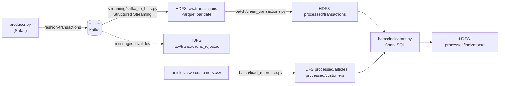

# Semaine 2 — Kafka → Spark → HDFS → analyse batch

Réalisée par : Nada Rian (Spark et traitements)

Jalon de la fiche : **démonstration intermédiaire Kafka → Spark → HDFS → analyse batch**.

## 1. Flux de données



## 2. Organisation HDFS (contrat commun avec le stockage)

| Chemin HDFS | Écrit par | Contenu | Format |
|---|---|---|---|
| `/voguemind/raw/transactions/` | `streaming/kafka_to_hdfs.py` | Transactions valides reçues de Kafka (+ partition et offset Kafka) | Parquet, partitionné par `t_dat` |
| `/voguemind/raw/transactions_rejected/` | `streaming/kafka_to_hdfs.py` | Messages refusés + motif (`json_invalide`, `prix_invalide`, …) | Parquet |
| `/voguemind/checkpoints/kafka_to_hdfs/` | Spark Structured Streaming | Offsets Kafka déjà traités (reprise après arrêt) | interne Spark |
| `/voguemind/raw/articles.csv`, `customers.csv` | dépôt manuel (HDFS) | Fichiers de référence H&M | CSV |
| `/voguemind/processed/articles/`, `customers/` | `batch/load_reference.py` | Référentiels nettoyés | Parquet |
| `/voguemind/processed/transactions/` | `batch/clean_transactions.py` | Historique dédoublonné et filtré | Parquet, partitionné par `t_dat` |
| `/voguemind/processed/quality/transactions/` | `batch/clean_transactions.py` | Rapport qualité de chaque exécution | Parquet |
| `/voguemind/processed/indicators/<nom>/` | `batch/indicators.py` | Indicateurs métier | Parquet |
| `/voguemind/models/` | semaine 3 | Modèles ML sauvegardés | Spark ML |

Toutes les écritures Spark utilisent la réplication 2 (`spark.hadoop.dfs.replication 2`).

## 3. Les traitements

### 3.1 Streaming Kafka → HDFS (`streaming/kafka_to_hdfs.py`)

- Lecture du topic `fashion-transactions` sur `kafka:29092`, depuis le début (`earliest`), par micro-batchs de 20 000 messages maximum.
- Lecture du JSON avec le schéma exact des événements du producer.
- **Validation** de chaque message : JSON lisible, `customer_id` présent, `article_id` à 10 chiffres (le zéro initial perdu est rétabli), date valide, prix > 0, canal 1 ou 2. Les messages invalides ne sont pas perdus : ils sont rangés à part avec leur motif.
- Écriture en Parquet partitionné par date d'achat, avec **checkpoint** : si le job s'arrête, il reprend au dernier offset traité, sans perte ni doublon.
- Deux modes : continu (micro-batch toutes les 10 s) ou `--once` (traite tout ce qui est disponible puis s'arrête, utile pour la démo).

### 3.2 Référentiels (`batch/load_reference.py`)

Conversion en Parquet des articles (obligatoire) et des clients (facultatif). Les identifiants restent en texte pour garder le zéro initial. Les clients reçoivent une tranche d'âge. Si seul `articles_sample.csv` (1 000 articles) est présent, le script prévient que les jointures seront partielles.

### 3.3 Nettoyage (`batch/clean_transactions.py`)

| Règle | Raison |
|---|---|
| Doublons sur `transaction_id` → garder la dernière ingestion | Si le producer est relancé, les mêmes transactions sont renvoyées |
| Prix hors de ]0 ; 1] retirés | Les prix H&M sont normalisés entre 0 et 1 |
| Valeurs manquantes contrôlées par colonne | Rapport affiché et enregistré |

Les vrais achats multiples (même client, même article, même jour) sont **conservés** : ils ont des `transaction_id` différents.

### 3.4 Indicateurs (`batch/indicators.py`, Spark SQL)

| Indicateur | Question métier |
|---|---|
| `kpi_global` | Volume, clients, articles, chiffre d'affaires, panier moyen, période couverte |
| `ventes_par_jour` | Comment évoluent les ventes dans le temps ? |
| `top_articles` | Quels sont les 20 articles les plus vendus ? |
| `ventes_par_categorie` | Quels groupes de produits pèsent le plus dans le CA ? |
| `ventes_par_rayon` | Ladieswear, Menswear, Baby/Children… |
| `ventes_par_canal` | Répartition entre les canaux de vente 1 et 2 |
| `ventes_par_age` | Ventes par tranche d'âge (si `customers.csv` est chargé) |

Le script affiche aussi la **couverture** de la jointure : la part des transactions dont l'article est connu dans le référentiel.

Les prix étant normalisés par Kaggle, le chiffre d'affaires sert à comparer, pas à donner un montant réel.

## 4. Démonstration

```bash
docker compose up -d
python3 ingestion/producer.py --limit 5000 --delay 0     # Safae : publie des transactions
./scripts/run_week2.sh                                    # tout le reste
```

Le script enchaîne : offsets Kafka disponibles → streaming `--once` → référentiels → nettoyage → indicateurs → contenu HDFS et réplication.

Pour montrer le **vrai streaming** pendant la démo, ouvrir deux Terminaux :

```bash
# Terminal 1 : le job écoute Kafka en continu
docker compose exec spark-master /opt/spark/bin/spark-submit /opt/voguemind/streaming/kafka_to_hdfs.py
# Terminal 2 : envoi de nouvelles transactions
python3 ingestion/producer.py --limit 200 --delay 0.05
```

Le Terminal 1 affiche `[batch N] X transactions archivées, Y rejetées` à chaque micro-batch.

**Données de référence :** pour des indicateurs par catégorie complets, mettre le fichier complet `articles.csv` dans `data/` ou dans HDFS (`/voguemind/raw/articles.csv`). `customers.csv` est facultatif.

## 5. Tests réalisés en local (données de test)

| Test | Résultat |
|---|---|
| 300 messages valides + 2 doublons + 3 invalides | 303 archivés, 3 rejetés avec le bon motif (`json_invalide`, `prix_invalide`, `article_id_invalide`) |
| Nettoyage | 2 doublons supprimés, 300 lignes propres, aucune valeur manquante |
| Indicateurs | 7 tables produites ; couverture articles calculée (83 % avec l'échantillon de 1 000 articles) |

Résultats sur le cluster avec les vraies transactions H&M : captures à ajouter.
