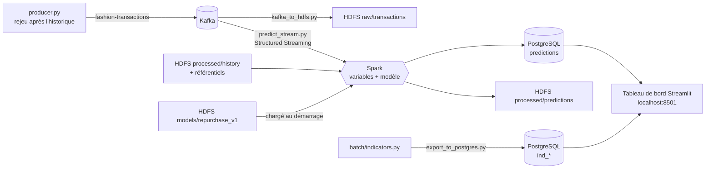

# Semaine 4 — Inférence temps réel, base de restitution et tableau de bord

Réalisée par : Nada Rian (Spark et traitements)

Jalon de la fiche : **démonstration complète du producteur à la visualisation**.

## 1. Architecture finale



Nouveaux conteneurs dans le `docker-compose.yml` commun :

| Service | Image | Port hôte | Rôle |
|---|---|---|---|
| `postgres` | `postgres:16-alpine` | 5433 | Base de restitution (volume persistant `postgres_data`) |
| `dashboard` | `voguemind/dashboard:1.0` (Streamlit) | 8501 | Tableau de bord, rafraîchi toutes les 5 s |

## 2. Inférence temps réel (`streaming/predict_stream.py`)

1. Au démarrage, le job **charge le modèle sauvegardé** (`/voguemind/models/repurchase_v1`) et met en mémoire les dernières semaines d'historique ainsi que les référentiels.
2. Pour chaque micro-batch Kafka (toutes les 5 s) :
   - il valide les messages avec les mêmes règles que `kafka_to_hdfs.py` ;
   - il recalcule les variables des clients concernés avec **le même module que l'entraînement** (`batch/features.py`), à partir de l'historique HDFS, des achats déjà reçus et du batch courant ;
   - il prédit la probabilité de réachat sous 7 jours ;
   - il écrit le résultat dans PostgreSQL (table `predictions`) et l'archive dans HDFS (`processed/predictions`).
3. Les conventions sont identiques à l'entraînement : un client qui achète le jour *d* est scoré avec une coupure au jour *d + 1*.

Le job utilise **1 cœur** (`spark.cores.max=1`). L'autre worker reste libre pour les traitements batch.

## 3. Base de restitution (PostgreSQL)

| Table | Écrite par | Contenu |
|---|---|---|
| `predictions` | `predict_stream.py` | Une ligne par transaction scorée : client, article, probabilité, prédiction, version du modèle, heure d'envoi, heure d'arrivée Kafka, heure du score |
| `ind_kpi_global`, `ind_ventes_par_jour`, `ind_top_articles`, `ind_ventes_par_categorie`, `ind_ventes_par_rayon`, `ind_ventes_par_canal`, `ind_ventes_par_age` | `export_to_postgres.py` | Indicateurs de ventes calculés par Spark SQL |

Le schéma est créé automatiquement au premier démarrage (`infra/postgres/init.sql`).

## 4. Tableau de bord (`dashboard/app.py`)

Ouvrir **http://localhost:8501**. Trois onglets :

- **Temps réel :** transactions scorées, part de réachats prédits, probabilité moyenne, **délai observé** entre l'envoi par le producer et l'écriture en base, transactions par minute, répartition des probabilités, dernières prédictions. Cet onglet se rafraîchit automatiquement toutes les 5 secondes.
- **Ventes :** indicateurs de l'historique (KPI, ventes par jour, groupes de produits, rayons, top 20 des articles).
- **Modèle de réachat :** comparaison des trois techniques, réglage, évaluation sur le test et matrice de confusion (lus dans `results/ml_metrics_v1.json`).

## 5. Démonstration complète

```bash
./scripts/run_week3.sh                 # si pas encore fait : historique + modèle + indicateurs
./scripts/run_week4.sh                 # PostgreSQL + tableau de bord + job de prédiction
python3 ingestion/producer.py --start-date 2018-12-13 --limit 2000 --delay 0.05
./scripts/run_week4.sh status          # journal du job + contenu de la base
```

`--start-date` vaut la date affichée à la fin de `load_history.py` : le producer rejoue les achats **postérieurs** à l'historique d'entraînement, comme des achats « du jour ».

## 6. Vérification de la reprise

1. Pendant l'envoi des transactions, arrêter le job : `./scripts/run_week4.sh stop`.
2. Continuer à envoyer des transactions avec le producer.
3. Relancer le job : `./scripts/run_week4.sh`.
4. Résultat attendu : le job repart au dernier offset enregistré dans le checkpoint (`/voguemind/checkpoints/predict_stream/`) et score les transactions envoyées pendant l'arrêt. Aucune transaction n'est perdue, et la clé primaire `transaction_id` empêche les doublons même si un batch est rejoué.

Ce mécanisme a été testé en local en rejouant deux fois le même batch : 400 transactions écrites la première fois, 0 nouvelle ligne la seconde.

## 7. Captures à ajouter au rapport

1. `./scripts/run_week4.sh status` pendant le flux (délai moyen et nombre de prédictions)
2. Onglet **Temps réel** du tableau de bord
3. Onglet **Ventes**
4. Onglet **Modèle de réachat**
5. Journal montrant la reprise après `stop` et redémarrage
