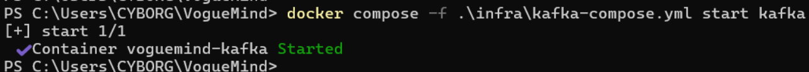
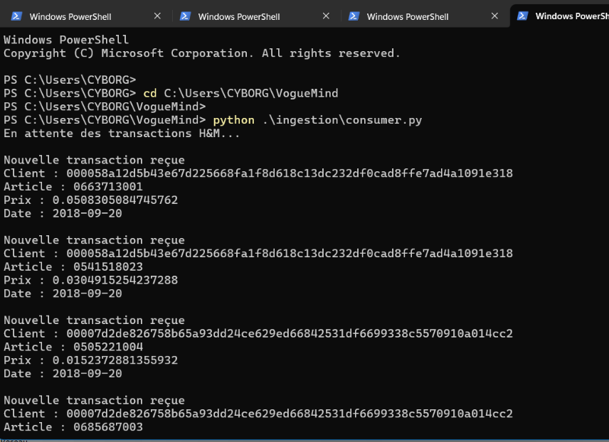
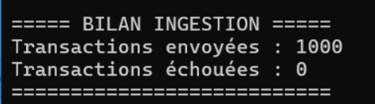
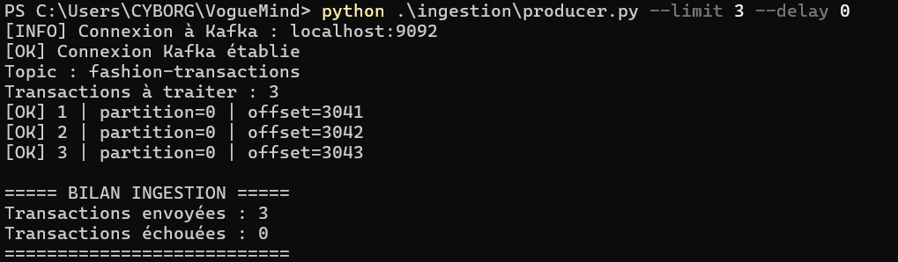

# VogueMind — Pipeline d'ingestion Apache Kafka

## 1. Présentation

VogueMind est un projet Big Data utilisant le dataset H&M Personalized Fashion Recommendations.

Ce module permet de lire les transactions H&M depuis un fichier CSV et de les publier dans Apache Kafka sous forme d'événements JSON.

**Responsable :** Personne 1 — Ingestion des données.

## 2. Technologies utilisées

- Apache Kafka 4.0.0
- Docker et Docker Compose
- Python 3.11
- pandas 2.2.3
- kafka-python 3.0.11

## 3. Architecture du pipeline

```text
Dataset H&M
    |
    v
transactions_train.csv
    |
    v
producer.py (Python)
    |
    v
Apache Kafka
Topic : fashion-transactions
    |
    v
Consommateurs Kafka / Spark Streaming
```

L'intégration avec Spark Streaming constitue une étape distincte du projet.

## 4. Organisation des fichiers

```text
VogueMind/
├── data/
│   └── transactions_train.csv
├── infra/
│   └── kafka-compose.yml
└── ingestion/
    ├── producer.py
    ├── consumer.py
    ├── requirements.txt
    └── README-KAFKA.md
```

Le dataset complet n'est pas publié sur GitHub.

## 5. Installation des dépendances

Depuis la racine du projet :

```powershell
python -m pip install -r .\ingestion\requirements.txt
```

## 6. Démarrage de Kafka

```powershell
docker compose -f .\infra\kafka-compose.yml up -d
```

Vérifier le conteneur :

```powershell
docker compose -f .\infra\kafka-compose.yml ps
```

Kafka est accessible depuis Windows sur `localhost:9092` et depuis les conteneurs du réseau Docker `voguemind-net` sur `kafka:29092`.

## 7. Exécution du producer

Envoyer 3 transactions pour un test rapide :

```powershell
python .\ingestion\producer.py --limit 3 --delay 0
```

Envoyer 1 000 transactions :

```powershell
python .\ingestion\producer.py --limit 1000 --delay 0.1
```

Le producer accepte deux paramètres :

- `--limit` : nombre de transactions à lire.
- `--delay` : délai entre deux envois, en secondes.

## 8. Format des événements

Chaque transaction est publiée dans le topic `fashion-transactions` au format JSON.

Exemple simplifié :

```json
{
  "transaction_id": "tx_0",
  "customer_id": "000058a12d5b43e67d225668fa1f8d618c13dc232df0cad8ffe7ad4a1091e318",
  "article_id": "0663713001",
  "timestamp": "2018-09-20",
  "price": 0.0508305084745762,
  "sales_channel_id": 2,
  "event_type": "purchase",
  "ingestion_timestamp": "2026-11-08T20:56:48.618647+00:00"
}
```

## 9. Vérification des messages Kafka

Lister les topics :

```powershell
docker exec voguemind-kafka /opt/kafka/bin/kafka-topics.sh --bootstrap-server localhost:9092 --list
```

Lire trois messages depuis le début du topic :

```powershell
docker exec voguemind-kafka /opt/kafka/bin/kafka-console-consumer.sh --bootstrap-server localhost:9092 --topic fashion-transactions --from-beginning --max-messages 3
```

## 10. Tests réalisés

Les tests suivants ont été effectués :

| Test                                   | Résultat                |
| -------------------------------------- | ----------------------- |
| Démarrage Kafka avec Docker Compose    | Réussi                  |
| Connexion du producer Python           | Réussi                  |
| Envoi de 1 000 transactions            | 1 000 envoyées, 0 échec |
| Envoi supplémentaire de 3 transactions | 3 envoyées, 0 échec     |
| Lecture de 3 messages JSON             | Réussi                  |
| Détection d'une panne Kafka            | Réussi                  |
| Redémarrage Kafka                      | Réussi                  |
| Lecture des messages après redémarrage | Réussi                  |

Les trois transactions du dernier test ont été enregistrées aux offsets `3041`, `3042` et `3043`.

## 11. Captures d'écran

Les captures suivantes présentent les résultats des tests du pipeline d'ingestion Kafka de VogueMind.

### 11.1. Démarrage de Kafka avec Docker

La capture montre le démarrage du conteneur `voguemind-kafka`.



### 11.2. Réception des transactions avec le consumer

Le consumer Python reçoit les transactions H&M et affiche les informations des clients, articles, prix et dates.



### 11.3. Ingestion de 1 000 transactions

Le producer a envoyé 1 000 transactions vers le topic `fashion-transactions`, sans échec.



### 11.4. Test d'envoi de 3 transactions

Ce test confirme l'envoi de trois événements avec les offsets Kafka `3041`, `3042` et `3043`.



## 12. Arrêt de Kafka

```powershell
docker compose -f .\infra\kafka-compose.yml stop kafka
```

Pour le redémarrer :

```powershell
docker compose -f .\infra\kafka-compose.yml start kafka
```

Ne pas supprimer les volumes Docker contenant les données Kafka lors des opérations de maintenance.

## 13. Prochaine étape

Connecter Apache Spark Structured Streaming au topic `fashion-transactions` afin de traiter les événements et de les intégrer au pipeline Big Data VogueMind.
